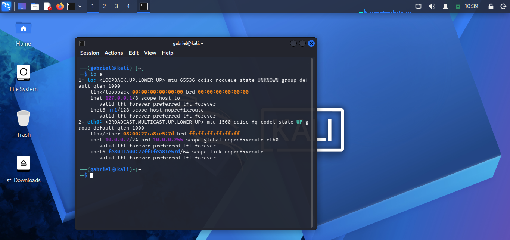
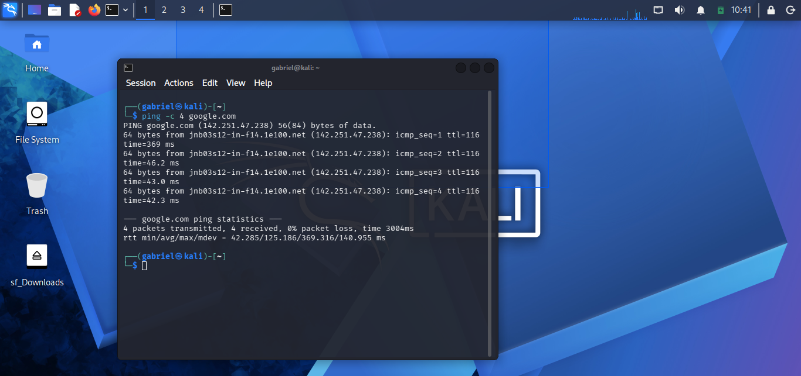
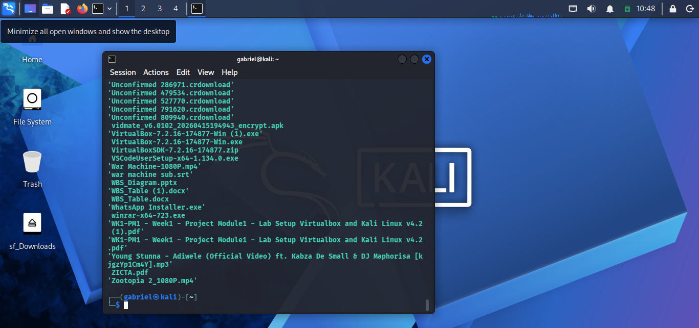
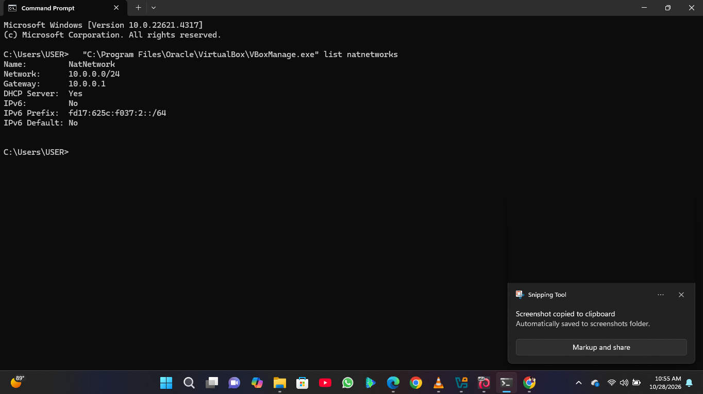
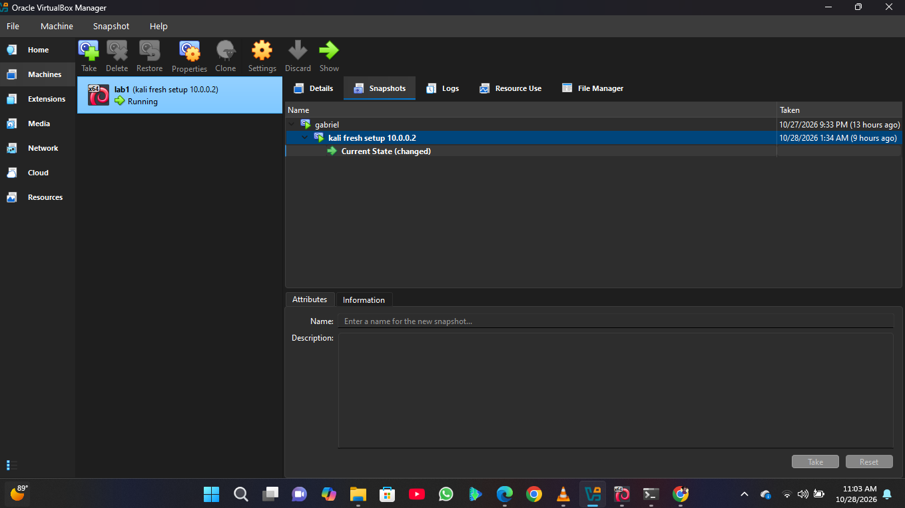
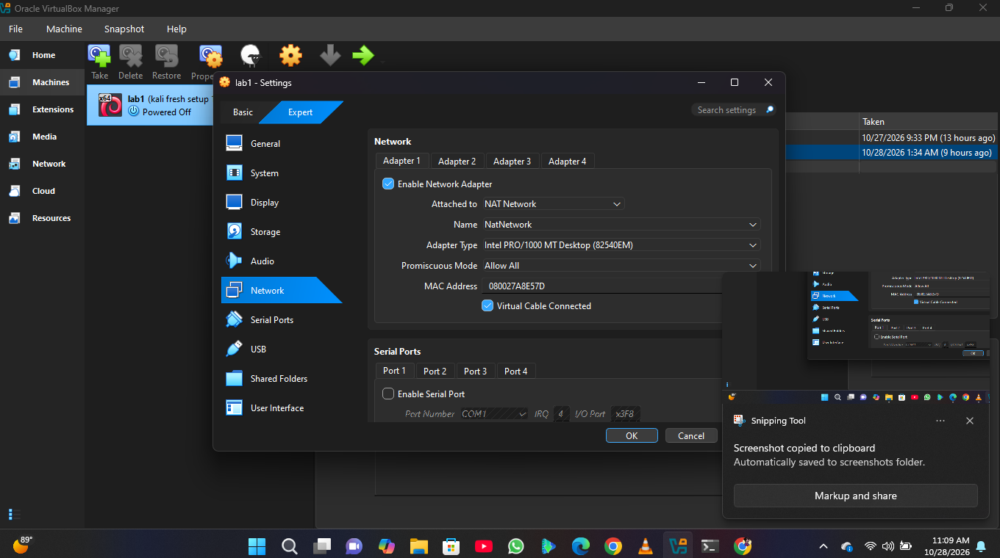
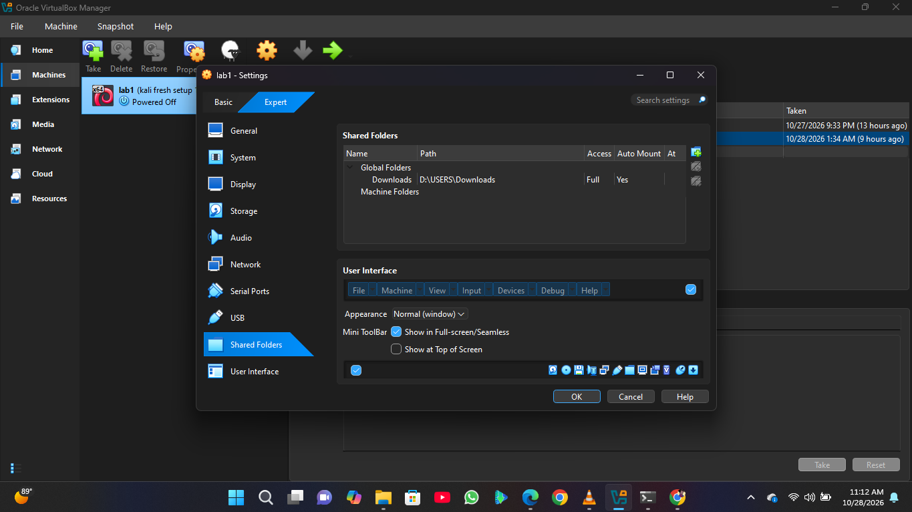
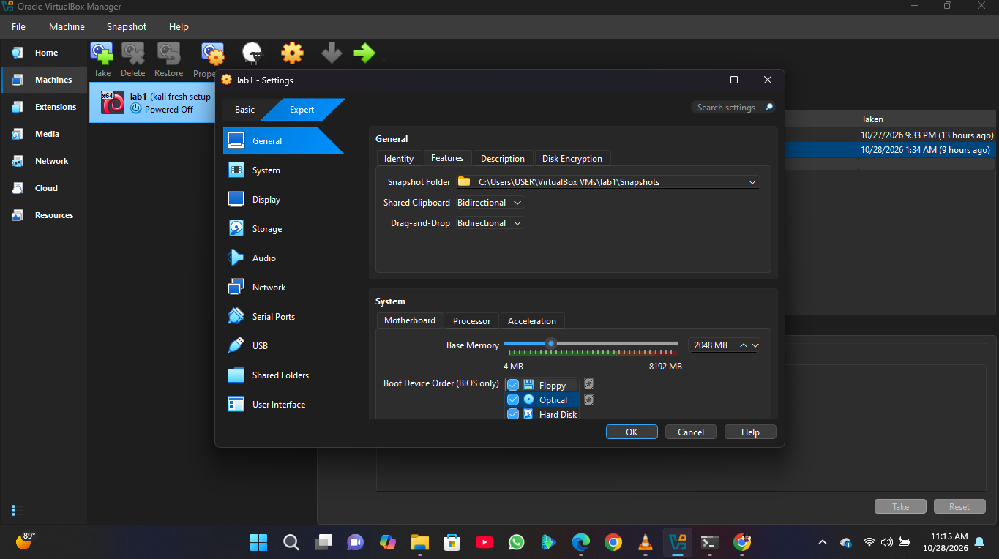

# Cybersecurity Lab Environment Setup

Week 1 project: a virtual lab for ethical hacking practice, built on my own computer with VirtualBox and Kali Linux.

## What I built
- VirtualBox with a Kali Linux VM as the attacking machine
- A NAT Network (`NatNetwork`) in the 10.0.0.0/24 subnet
- Kali with a static IP of 10.0.0.2/24 and full internet access
- Shared clipboard and drag and drop enabled
- Windows Downloads folder shared with Kali
- A snapshot of the finished setup

## Steps
1. Installed VirtualBox and created the Kali Linux VM.
2. Created the NAT Network `NatNetwork` with prefix 10.0.0.0/24 and DHCP on.
3. Installed the VirtualBox guest tools in Kali for clipboard, drag and drop and shared folders.
4. Set Adapter 1 to NAT Network and enabled the shared clipboard, drag and drop, and the Downloads shared folder.
5. Set the static IP 10.0.0.2/24 with gateway 10.0.0.1 using `nmcli`.
6. Tested the internet, shared folder and clipboard.
7. Took a snapshot of the VM.

## Screenshots

### 1. Kali IP address

### 2. Internet test

### 3. Shared folder in Kali

### 4. NAT Network

### 5. Snapshot

### 6. VM network settings

### 7. Shared folder settings

### 8. Clipboard and drag and drop

## Problem I faced and the fix
The `nmcli` command failed with "unknown connection". The name must match exactly (`Wired connection 1`, capital W), and I had also typed a dot instead of a space in the command. Correcting both fixed it.

## Note
This was all done in my own virtual lab on my own computer, for learning only.
